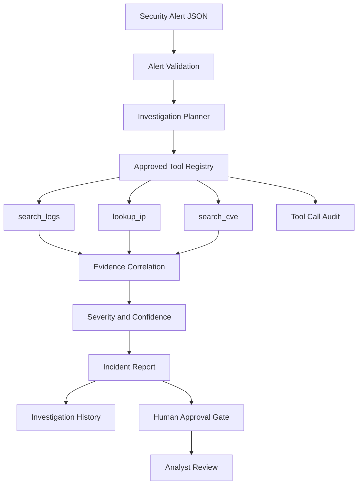

# Hermes-Powered AI Security Operations Centre (SOC)

A prototype AI SOC analyst that investigates suspicious account-login alerts using approved local tools, correlates available evidence, assesses severity and confidence, and generates structured incident reports.

## 1. Project objectives

The prototype addresses the following security investigation workflow:

1. Receive a structured security alert.
2. Validate the alert data.
3. Search supplied authentication logs.
4. Look up the source IP in a local mock intelligence catalogue.
5. Search a local mock vulnerability catalogue when a software product is supplied.
6. Correlate available events into a timestamped timeline.
7. Assess severity and confidence separately.
8. Generate JSON and Markdown incident reports.
9. Record investigation history and tool-call audit records.
10. Require explicit human approval before a disruptive response action.

## 2. Architecture



**Hermes runtime status:** The project includes an adapter interface for the three approved tools. The actual Cehpoint-selected Hermes runtime must be identified, configured, and demonstrated before claiming completed Hermes orchestration.

## 3. Project structure

```text
Cehpoint_Hermes_AI_SOC/
├── src/
│   └── soc/
│       ├── agent/
│       │   ├── planner.py
│       │   ├── entrypoint.py
│       │   └── hermes_adapter.py
│       ├── tools/
│       │   ├── common.py
│       │   ├── registry.py
│       │   ├── search_logs.py
│       │   ├── lookup_ip.py
│       │   └── search_cve.py
│       ├── investigation/
│       │   └── engine.py
│       ├── reporting/
│       │   └── generator.py
│       ├── audit/
│       │   └── history.py
│       └── safety/
│           └── approval.py
├── schemas/
│   ├── alert.schema.json
│   └── tool_schemas.json
├── data/
│   ├── alerts/
│   ├── logs/
│   └── intelligence/
├── reports/
├── audit_logs/
├── tests/
├── docs/
└── README.md
```

## 4. Investigation scenario

The supplied synthetic scenario represents:

- 50 failed login attempts against one account.
- A subsequent successful login.
- A related host-login event.
- A source IP from a documentation-reserved address range.

The sample data is synthetic. It must not be interpreted as evidence of an actual attacker or real-world malicious IP.

## 5. Tools

| Tool | Purpose | Data source |
|---|---|---|
| `search_logs` | Search authentication events | Synthetic JSONL logs |
| `lookup_ip` | Look up IP reputation | Local mock catalogue |
| `search_cve` | Search product vulnerability records | Local mock catalogue |

All tools are accessed through an approved registry. Unregistered tool names are rejected.

## 6. Reports and audit records

The application generates:

- `reports/incident_report.json`
- `reports/incident_report.md`

Audit records:

- `audit_logs/tool_calls.jsonl`
- `audit_logs/investigation_history.jsonl`
- `audit_logs/response_approvals.jsonl`

## 7. Running in Google Colab

1. Open the project notebook.
2. Mount Google Drive.
3. Set the project path to:

   `/content/drive/MyDrive/Cehpoint_Hermes_AI_SOC`

4. Ensure the project files and synthetic datasets exist.
5. Add the project `src` directory to Python's import path.
6. Run the investigation and report-generation workflow.
7. Run the automated tests.

Example:

```python
import sys
from pathlib import Path

PROJECT = Path("/content/drive/MyDrive/Cehpoint_Hermes_AI_SOC")
sys.path.insert(0, str(PROJECT / "src"))
```

Run tests:

```bash
python -m unittest discover -s tests -p "test_*.py" -v
```

## 8. Safety controls

- Synthetic or explicitly authorized data only.
- No real-world scanning or exploitation.
- No automatic account disabling, IP blocking, host isolation, or deletion.
- Unapproved tool names are rejected.
- Disruptive actions require an approval record.
- Approval demonstrations do not execute production actions.
- Mock intelligence results are clearly distinguished from live intelligence.
- Secrets and credentials must not be committed to source control.

## 9. Limitations

- Local mock intelligence is not a live threat-intelligence service.
- Local mock vulnerability data is not a complete vulnerability database.
- Source IP reputation cannot establish the identity or intent of an actor.
- The prototype's analyst-name approval is not authenticated identity management.
- The supplied sample dataset is limited and synthetic.
- Actual Hermes runtime orchestration remains pending until the intended runtime is confirmed and demonstrated.

## 10. Testing

The project includes investigation tests and tool tests.

Record the actual test command, test count, failures, and execution environment before submission. Do not report unexecuted tests as passed.

## 11. Future improvements

- Integrate the exact Hermes runtime selected by Cehpoint.
- Connect an authorized SIEM or log source.
- Add authenticated analyst identity and role-based approval.
- Add a verified threat-intelligence provider.
- Add additional authorized incident scenarios.

## 12. Assessment alignment

The implementation is organized around the supplied Cehpoint assessment requirements: alert intake, approved tool use, evidence correlation, severity assessment, structured reporting, auditability, human approval, testing, documentation, and demonstration.
